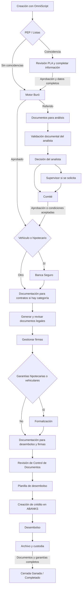

# Proceso de ResidentialLoanApplication en VimencaMergeQA

Revisión: 13 de octubre de 2026. Org: `VimencaMergeQA`, `00DVC000009qkJJ2AY`.

Esta guía reconstruye el comportamiento desplegado a partir de metadata obtenida de QA y consultas de lectura. Incluye creación con OmniStudio, acciones del LWC, Apex, aprobaciones, documentos, firmas, garantías y desembolso. No se crearon ni actualizaron solicitudes, no se ejecutaron integraciones y no se hicieron despliegues. Es un análisis de configuración y código; el recorrido de una solicitud concreta todavía debe comprobarse al ejecutarlo.

La evidencia detallada, las fórmulas y el catálogo de documentos están en [proceso-rla-vimencamergeqa-evidencia.md](proceso-rla-vimencamergeqa-evidencia.md). Esa evidencia conserva condiciones obtenidas de la org para futuras consultas, incluso si cambia el código local.

## 1. Cómo interpretar el proceso

`Status` es el estado general; `FSC_Subestado__c` identifica el paso operativo. Además del subestado, el proceso utiliza resultados de PEP/Listas y Buró, indicadores de documentación, decisiones de analista/supervisor/comité, responsables asignados y archivos relacionados.

| Estado general | Subestados |
| --- | --- |
| Borrador | Completando información |
| En proceso | Validaciones, análisis, documentos, firmas, formalización, creación de crédito, desembolso y archivo |
| Cerrada Ganada | Completado |
| Cerrada Perdida | Rechazos de PLA, Buró, análisis, supervisor, comité, Banca Seguro o cliente |

El final exitoso es **`Status = Cerrada Ganada` y `FSC_Subestado__c = Completado`**. La aprobación de Archivo y custodia también marca `FSC_Expediente_Archivado__c`. Desembolsar todavía deja trabajo pendiente.

El diagrama muestra el recorrido exitoso y sus principales ramas. Los rechazos, devoluciones y excepciones se explican más abajo.

## 2. Crear la solicitud

El proceso completo de creación está en los OmniScripts `FSC / SolicitudCreditoConsumo`, `SolicitudCreditoVehiculo`, `SolicitudCreditoHipotecario` y `SolicitudCreditoPYME`, idioma Spanish, con el cliente como contexto. En QA están activas las versiones Consumo 12, Vehículo 5, Hipotecario 5 y PYME 29.

Los tres primeros comparten la Integration Procedure `FSC_ActualizarCrearSolicitudCreditoConsumo`, versión 8. PYME utiliza `FSC_ActualizarCrearSolicitudCreditoPYME`, versión 14. Los Data Mappers crean o actualizan la solicitud y los relacionados. Crear únicamente el RLA por formulario/API puede dejar ausentes participantes, contactos, garantías, seguros o documentos que se necesitan más adelante.

**Consumo, vehículo e hipotecario:** primero se cargan solicitantes y se validan listas. Si hay coincidencia, puede crearse un borrador en `Completando información` con aprobación PLA pendiente. Tras resolverla, el Oficial utiliza **Completar información** para continuar el OmniScript. Sin coincidencias, al completar datos generales se guarda `En proceso / En Motor Buró`.

**PYME:** se completan datos de la persona o empresa, negocio, crédito, garantías, facilidades, propósito y uso de fondos, referencias y estados financieros. El transformador inicializa `En proceso / En validación PEP/Listas`; la llamada posterior a listas decide la continuación. Se valida la clasificación MIPYMES y la consistencia del estado de situación.

Controles de creación que conviene preparar:

- En los créditos personales se exige al menos un Deudor; el administrador de solicitantes impide agregar otro Deudor desde sus opciones.
- Cada Deudor debe tener al menos dos referencias completas.
- Los solicitantes deben tener ocupación, fuente de ingreso, tiempo laborando, ingresos mensuales y tipo de negocio completos. El mensaje menciona prestaciones laborales; el control global de datos laborales comprueba esos cinco campos. Un préstamo de convenio sí tiene un control específico de prestaciones.
- Codeudores y garantes necesitan correo válido al guardarse. Hay controles de identificación, referencias repetidas y cantidad de facilidades en otras instituciones.
- La facilidad pide tipo, facilidad/producto, monto, tasa, plazo, forma de pago y decisiones aplicables sobre tasa fija, convenio, modalidad y pagaré/contrato.
- Si la tasa es fija, se informa su duración, que no puede superar el plazo del crédito.
- Consumo exige seguro de vida; hipotecario exige vida e incendio; vehículo exige seguro de vehículo.
- Hipotecario exige al menos una garantía. Vehículo necesita la garantía y el año admitido para determinar el plazo.
- Si es convenio, completar prestaciones laborales del deudor. Si es consolidación, registrar al menos una facilidad externa del deudor.
- En PYME, el paso de facilidades exige al menos una facilidad y un propósito/uso de fondos; también un activo si la solicitud tiene garantía.

Las reglas declaradas de visibilidad y obligatoriedad del OmniScript se conservan en el anexo. Algunos campos dependen del producto, garantía, clase de persona y respuestas anteriores.

La matriz MIPYMES vigente llega hasta 150 empleados y ventas brutas anuales de 302.624.720,10. La IP clasifica ambas dimensiones y usa la categoría mayor; exige código de clasificación mayor que cero. Microempresa de Subsistencia tiene código cero, por lo que tampoco satisface esa validación. Estos valores describen la configuración de QA, no una regla regulatoria independiente.

## 3. Etapas y acciones para avanzar

| Etapa | Responsable / acción | Condición de salida |
| --- | --- | --- |
| Completando información | Resolver aprobación inicial y continuar con **Completar información** | Borrador sin aprobación pendiente; completar los datos generales |
| En validación PEP/Listas | Servicio de listas; PLA si existe coincidencia | Sin coincidencias o coincidencia aprobada lleva a Buró; rechazo cierra perdida |
| En Motor Buró | Automatización / **Reintentar Buró** si no hay resultado | Referido → documentos de análisis; aprobado → ruta documental; rechazado → cerrada perdida |
| Recepción de documentos – Análisis | Oficial: cargar archivos o marcar **No aplica** y enviar a revisión | `FSC_Doc_Completa_Analisis__c = true`; el flujo activo entra a análisis y asigna analista |
| Análisis de crédito, validación | Analista asignado: revisar checklist y **Validar documentación** | Todas las filas revisadas; `FSC_DocumentacionValidadaAnalista__c = true` |
| Análisis de crédito, decisión | Analista: aprobar/rechazar o enviar a Supervisor | Aprobar activa revisión de comité; Supervisor es una rama opcional |
| Análisis de crédito, Supervisor | Supervisor: aprobar/rechazar o devolver | Aprobar desactiva revisión de Supervisor y activa Comité |
| Análisis de crédito, Comité | Comité: aprobar, aprobar con condiciones o rechazar | Aprobación simple → documentos; con condiciones → decisión del cliente |
| Banca Seguro | Revisor asignado de Banca Seguro | Aprobación → Documentación para contratos; rechazo → cerrada perdida |
| Documentación para contratos | Creador del RLA o administrador: cargar y enviar documentación | Cada documento tiene archivo o No aplica; entra a generación para revisión |
| Generación de pagarés y plantillas | Responsable de pagarés: aprobar checklist de contratos, completar datos y generar | Se generan archivos; permanece en esta etapa para revisar y validar |
| Generación de contrato | Automatización y contexto de generación existente | Generación asíncrona; no tratar la existencia de un archivo como validación final |
| Gestionar firmas | Oficial/administrador: enviar, consultar estado y confirmar firma física | Firmas digitales completas y confirmación física cuando corresponde |
| Formalización | Responsable asignado con permiso de Formalización | Registrar garantías o elegir avanzar sin registrar; pendientes deben resolverse antes del cierre |
| Documentación para desembolso y firmas | Oficial: completar checklist y enviar a revisión; Control de Documentos: revisar y aprobar | `FSC_Doc_Completa_Desembolso__c = true` y aprobación → planilla |
| Pendiente planilla de desembolso | Responsable de planilla: elegir forma/cuenta, completar OmniScript | Guarda hoja de desembolso y pasa a Creación de crédito |
| Creación de crédito | API si cuenta de ahorro; Captura si desembolso manual | Número de préstamo; la ruta de ahorro requiere validación ABANKS antes de pasar a Desembolso |
| Desembolso | API si ahorro; Operaciones si manual | Desembolso exitoso/confirmado → Archivo y custodia |
| Archivo y custodia | Responsable asignado: aprobar expediente | Desembolso realizado, documentación sin pendientes y garantías formalizadas → Completado |

### Documentos para análisis

La aprobación antigua `FSC_RecepcionYControlDeDocs` está **inactiva** y su flujo está **Obsolete**. En el recorrido desplegado, al enviar la documentación de análisis se activa `FSC_ProcesoAprobacionAnalista`: prepara `Análisis de crédito`, reinicia la validación documental y asigna el analista. No hace falta una aprobación separada de recepción de documentos para análisis.

Para **enviar a revisión**, cada fila de la categoría necesita archivo o `No aplica`. Para **validar/aprobar**, cada fila debe quedar en `Aprobado` u `Observado`; si está Observado, necesita comentario. El código de aprobación permite Observado con comentario. En contratos la exigencia es más estricta: todas las filas deben estar Aprobadas.

Los archivos del checklist se vinculan a `FSC_SolicitudDeCreditoYChecklistDeDocs__c`. Adjuntar únicamente un archivo al RLA no siempre satisface la fila correspondiente. La precarga puede vincular documentos generados automáticamente a determinadas filas.

### Analista, Supervisor y Comité

Estas decisiones comparten `Análisis de crédito`; cambian el proceso pendiente y las banderas:

- Analista: Buró Referido, documentación completa, sin revisión de Supervisor ni Comité y sin aprobación con condiciones. Primero valida documentación; después decide.
- Supervisor: `FSC_DebeRevisarSupervisor__c = true`, Comité false.
- Comité: `FSC_DebeRevisarComite__c = true`, Supervisor false.
- La aprobación requiere comentario de hasta 255 caracteres. La aprobación simple del Comité conserva monto, plazo y tasa solicitados como aprobados.
- Aprobar con condiciones exige en el LWC monto, plazo y tasa aprobados. Se registra la decisión y el Oficial responde si el cliente acepta. Aceptación continúa a documentos; rechazo cierra `Cerrada Perdida / Rechazada por cliente`.

El flujo de Comité selecciona cola por tipo de crédito y monto: Comité I hasta 2.500.000 para PYME o 7.000.000 para los otros tipos; Comité II hasta 25.000.000; Comité III hasta 100.000.000. Los valores se comparan directamente con `FSC_Monto__c`, sin conversión monetaria en esa decisión. Por encima de 100.000.000 el conector por defecto vuelve a Comité I: es una particularidad de la implementación que conviene revisar si una prueba alcanza ese monto.

### Contratos, pagarés y revisión legal

`FSC_DocumentacionContratosService` intercepta la entrada a generación:

- Vehículo e hipotecario pasan antes por Banca Seguro si no está aprobada.
- Si el catálogo contiene documentos para confección de contrato, se pasa a Documentación para contratos.
- El **creador** del RLA o administrador envía la documentación; ser propietario u Oficial no equivale automáticamente a ser creador.
- El responsable de pagarés y contratos necesita su permiso además de la asignación para revisar y generar.
- Si pide documentación adicional, se reabre la categoría y se exige un archivo o una versión nueva posterior al pedido.

El modal de generación varía según persona/empresa, garantía y plantilla. Puede pedir identificación y domicilio de intervinientes, representante legal, fiadores, datos de título/vehículo/CD, pólizas, endosos y gastos hipotecarios.

El pagaré notarial necesita acto y folio numérico. Ambos se controlan para evitar duplicados con otras solicitudes. En Consumo, el resolvedor decide el tipo según monto solicitado, garantía y fiador: monto superior a 2.000.000, indicador notarial o garantía vehicular/hipotecaria conduce a notarial; sola firma suele usar simple; con fiador solidario usa simple con fiador; CD puede usar complementario.

En el proceso actual **Generar no avanza a firmas**. Se genera el pagaré, se encola el resto y se conserva el subestado para revisar los documentos. Después se usa **Validar documentos legales**, que exige todos los documentos requeridos y lleva a `Gestionar firmas`. Existen edición y reintento en esa etapa; un archivo antiguo puede no tener la copia editable requerida por el nuevo servicio.

### Firmas

La configuración vigente para los cuatro tipos tiene **Planilla digital, Pagaré físico y Contrato físico**. Aquí “Planilla” en configuración de firmas corresponde al documento inicial de solicitud de crédito que busca `FSC_FirmarDocumentoUtility`; la hoja de desembolso se genera más tarde.

La firma digital usa envelopes. El envío marca `FSC_EnviadoAFirmar__c`; la consulta/descarga y los triggers de archivos detectan documentos firmados. También se solicita confirmación de firmas físicas. No basta con haber enviado el envelope.

Cuando se completa la firma, los registros `FSC_Garantia__c` de grupos hipotecario o vehicular llevan a Formalización. Sin garantías de esos grupos, se pasa a Documentación para desembolso y firmas. La lógica revisada consulta ese objeto; no consulta `LoanApplicationAsset` para decidir formalización, aunque esos activos intervienen en contratos de PYME.

### Formalización

La org tiene `FSC_UsuarioFormalizacion__c` y un flujo que selecciona responsable de `FSC_GestionFormalizacion` al entrar a la etapa. Para operar se necesita `FSC_CP_Formalizacion_Creditos` y ser el asignado, o permiso administrador. Sin asignación, el controlador permite operar a un usuario con el permiso de Formalización.

- Hipotecaria: título registrado = Sí y fecha de formalización.
- Vehicular: garantía constituida = Sí, fecha de constitución y comentario.
- Las fechas no pueden ser futuras. El comentario vehicular es obligatorio y admite hasta 1.000 caracteres.
- La opción de avanzar sin registrar únicamente permite continuar a documentación de desembolso. No ejecuta el desembolso por sí misma ni elimina la obligación de formalizar.
- Apex bloquea tanto la aprobación de Archivo y custodia como el cambio a Cerrada Ganada/Completado si quedan garantías aplicables pendientes.

### Planilla y desembolso

El responsable de planilla necesita `FSC_CP_Desembolso_Creditos` y su asignación, o permiso administrador. El LWC pide primero la forma de desembolso. Si es Cuenta de ahorro, hay que seleccionar una cuenta válida del cliente; después abre `FSC / PlanillaDesembolso / Spanish`, versión 13.

La planilla solicita monto a desembolsar, clasificación SIB, código de aprobación, comisión de administración de seguro, forma de desembolso, esquema de amortización, línea financiera, subaplicación, producto, mora, período de tasa y otras condiciones que dependen de la selección. `FSC_PlanillaDesembolsoSaver` guarda los datos y lleva a `Creación de crédito`.

Hay dos rutas:

| Forma de desembolso | Creación de crédito | Desembolso |
| --- | --- | --- |
| Cuenta de ahorro | Consulta de producto y API de préstamo; conserva la etapa hasta que el responsable valida en ABANKS | API de desembolso hacia la cuenta seleccionada |
| Cheque de administracion | Captura manual por responsable con `FSC_CP_Captura` | Operaciones manuales con `FSC_CP_EjecucionOperaciones` |
| Cuenta de ahorro y Cheque de administración | Misma ruta manual | Misma confirmación manual |

En Captura manual se informa número de préstamo y se confirma captura del crédito, garantías y seguros según corresponda. En Operaciones se cargan **al menos un archivo de amortización y un recibo de desembolso**, diferentes entre sí. Se admiten PDF, Word, Excel, JPG/JPEG y PNG para esa acción; las extensiones del checklist general son distintas.

La API de préstamos valida datos del cliente, agencia/usuario ABANKS, condiciones aprobadas, cuota, vencimiento, producto/subaplicación, tipo y revisión de tasa, fechas de primer pago y datos de garantías/seguros. La API de desembolso necesita número de préstamo, deudor/identificación, agencia/usuario, cuenta y códigos del producto de la cuenta. PYME contempla un respaldo con datos de Account cuando no hay LoanApplicant Deudor.

Los errores se reflejan en `FSC_FlagErrorAPIPrestamos__c`, `FSC_FlagErrorAPIDesembolso__c` y `FSC_LogErrores__c`. Tener número de préstamo con subestado Creación de crédito puede ser correcto: falta la validación de ABANKS. El reintento de creación está bloqueado si ya existe número de préstamo.

### Archivo y custodia

Con desembolso realizado y sin pendiente documental posterior, se inicia la aprobación. Aprobar marca expediente archivado y cierra ganada/completada.

Rechazar en esta etapa **devuelve documentación para corregir**, mediante `FSC_Doc_Incompleta_Post_Desembolso__c` y una tarea; no utiliza el cierre perdido de análisis. El Oficial atiende lo pendiente y usa **Enviar a Archivo y Custodia**, con observaciones, para restablecer la revisión. El LWC de aprobación consulta además `FSC_Doc_Incompleta_Desembolso__c`; son campos distintos que deben comprobarse al diagnosticar un botón ausente.

## 4. Reglas de validación y límites vigentes

En ResidentialLoanApplication hay **cuatro validation rules, todas activas**, verificadas también por Tooling API:

| Regla | Qué bloquea |
| --- | --- |
| FSC_Validar_Tasa_Interes_Max_100 | Tasa solicitada o aprobada mayor que 1 en su almacenamiento; representa 100% |
| FSC_Validar_Gastos_Contrato_Hip | Gastos contractuales en créditos no hipotecarios, o gastos de garantía de 2% y 3% simultáneos |
| FSC_ValidarPlazoMaximoConsumo | Plazo solicitado/aprobado superior al máximo configurado, o configuración inválida |
| FSC_ValidarPlazoMaximoVehiculo | Plazo incompatible con antigüedad del vehículo; condiciones inválidas o falta de garantía admitida al aprobar |

En los relacionados revisados también hay dos reglas activas sobre garantías vehiculares, para año/antigüedad y plazo, y una sobre facilidades para plazo de 1 a 999 meses. Los mensajes y fórmulas exactos están en el anexo.

Configuración actual de plazos:

| Producto / antigüedad | Máximo |
| --- | --- |
| Consumo | 60 meses |
| Vehículo de 0 años | 84 meses |
| Vehículo de 1–2 años | 72 meses |
| Vehículo de 3–7 años | 60 meses |

El vehículo más antiguo determina el límite de la solicitud. No se admiten años futuros ni antigüedad superior a 7 años. Para vehículo, si ya se indicó un plazo largo, puede ser necesario reducirlo antes de guardar una garantía más antigua.

La mayoría de los bloqueos operativos se encuentra fuera de estas validation rules: checklists, validaciones de interfaz, `AuraHandledException`, `addError` de triggers, permisos/asignaciones, resolvedores de documentos e integraciones.

Después de la aprobación de comité, `FSC_CreditoAprobadoLockService` protege datos críticos de solicitud y relacionados. QA tiene excepciones controladas para completar redacción de contrato, formalización y campos vacíos durante planilla; no permite cambiar libremente condiciones ya aprobadas. Administrador tiene tratamiento especial mediante `FSC_CP_Administrador`.

## 5. Excepciones y devoluciones

**Excepción de Buró:** puede solicitarse desde Rechazado por Buró; utiliza `FSC_SolicitaExcepcionParaRechazoDeBuro__c` y la aprobación `FSC_Excepcion_Buro`. Si se aprueba, vuelve a En proceso, cambia resultado a Referido y entra a documentos de análisis.

**Excepciones de crédito generales:** se almacenan en `FSC_Excepcion__c`. Oficial/administrador puede solicitarlas en En proceso durante PEP/Listas, Motor Buró o Recepción de documentos – Análisis. La configuración actual admite hasta tres excepciones por solicitud. Requieren tipo, detalle y descripción; su catálogo/ruta se configura por metadata. Una excepción pendiente oculta acciones ordinarias del LWC. Si queda condicionada, el Oficial registra respuesta del cliente; rechazo de excepción o de sus condiciones cierra perdida.

**Devolver a Oficial:** cancela la aprobación pendiente, reinicia documentación completa/validada y vuelve a Recepción de documentos – Análisis. **Devolver a Analista:** reinicia la revisión de Supervisor y reanuda el proceso del analista. Usar esas acciones conserva las observaciones y la lógica de reenvío.

## 6. Por qué puede faltar un botón

Para una consulta concreta comprobar, en este orden:

1. Tipo de registro, Status y subestado exactos.
2. Resultado de listas/Buró y banderas de documentación/revisión/condiciones.
3. Proceso de aprobación pendiente y `ProcessInstanceWorkitem.ActorId`.
4. Usuario actual, permisos personalizados y responsable asignado para esa etapa.
5. Excepciones de crédito pendientes.
6. Filas del checklist: categoría, archivos, No aplica, estado de revisión y comentarios.
7. Documentos generados, configuración de firmas y estado del envelope.
8. Garantías pendientes de formalización.
9. En ABANKS, número de préstamo, forma/cuenta de desembolso y log de errores.

Ser administrador de perfil no debe confundirse con tener `FSC_CP_Administrador`. Las funciones operativas de pagarés, planilla, formalización, captura y operaciones validan permisos/asignación específicamente.

| Trabajo | Permiso personalizado principal | Asignación/contexto relevante |
| --- | --- | --- |
| Creación/carga/decisión del cliente | FSC_CP_Oficial_Negocio | Para documentos de contratos, CreatedById; para enviar firmas, el servidor también controla propietario |
| PLA | FSC_CP_Prevencion_Lavado_Activos | Aprobación pendiente y ActorId |
| Analista | FSC_CP_Analista_Credito | FSC_UsuarioAnalista__c y aprobación pendiente |
| Supervisor | FSC_CP_Supervisor | FSC_UsuarioSupervisor__c y aprobación pendiente |
| Comité | FSC_CP_Comite_Credito | FSC_UsuarioComite__c y aprobación pendiente; el LWC contempla permiso de Comité |
| Banca Seguro | FSC_CP_BancaSeguro | Aprobación pendiente |
| Pagarés y contratos | FSC_CP_Generacion_Pagares_Contratos | FSC_UsuarioPagaresYContratos__c |
| Formalización | FSC_CP_Formalizacion_Creditos | FSC_UsuarioFormalizacion__c |
| Revisión documental de desembolso | FSC_CP_Recepcion_Control_Documentos | FSC_UsuarioControlDocumentos__c y aprobación pendiente |
| Planilla de desembolso | FSC_CP_Desembolso_Creditos | FSC_UsuarioGestionPlanilla__c |
| Captura manual | FSC_CP_Captura | FSC_UsuarioCaptura__c |
| Operaciones manuales | FSC_CP_EjecucionOperaciones | FSC_UsuarioOperaciones__c |
| Archivo | FSC_CP_Archivo_Custodia_Valores | Aprobación pendiente |

La tabla es orientativa: hay que combinar las condiciones del getter del LWC, el método Apex y la aprobación. El anexo conserva los getters desplegados. Por ejemplo, las aprobaciones PLA durante Borrador tienen condiciones de interfaz distintas de PLA durante En proceso.

Los flujos suelen seleccionar usuarios activos desde colas y varios terminan sin enviar aprobación cuando no encuentran candidatos. Un subestado correcto con ninguna aprobación pendiente puede indicar una cola sin usuarios elegibles. También hay automatizaciones que dependen de **cambio** de campo (`ISCHANGED`); volver a guardar el mismo subestado no recrea necesariamente la aprobación.

La consulta principal del motor para créditos personales se encola en after update al cambiar a En Motor Buró; no se encola en after insert del trigger revisado. Si un RLA recién creado ya tiene ese subestado y queda sin resultado, comprobar si hubo transición posterior y revisar el botón Reintentar Buró. No concluir que la API se ejecutó solo por observar el subestado.

El Path muestra y resume el recorrido. Las transiciones y sus efectos están repartidos entre Apex, Flows y aprobaciones: actualizar manualmente el subestado puede disparar integraciones o dejar inconsistencias con aprobaciones y documentos.

## 7. Preparar una prueba completa

Antes de crear el caso, definir producto, cliente, monto, plazo, garantía y forma de desembolso. Identificar usuarios habilitados para las etapas que van a intervenir. Si se busca un primer recorrido con menos ramas, Consumo a sola firma tiene menos requisitos documentales y no tiene Banca Seguro ni formalización de garantía real; todavía requiere Buró, aprobación si resulta Referido, firmas, planilla, desembolso y archivo.

Usar el OmniScript de creación; completar datos y relacionados; esperar validaciones; resolver el checklist de análisis si resulta Referido; validar como analista; decidir y aprobar como comité; completar/revisar documentos legales; gestionar firma digital y física; completar formalización si aplica; cargar y aprobar documentos de desembolso; completar planilla; ejecutar/verificar la ruta ABANKS o manual; aprobar archivo.

Si un paso queda detenido, compartir **Id/enlace del RLA y texto exacto del error o botón ausente**. Con ese Id se puede consultar el contexto real y precisar qué dato, permiso, archivo o aprobación falta. No es necesario volver a reconstruir el proceso desde cero.

## 8. Alcance de lo comprobado y diferencias con el proyecto

Se recuperaron 4.106 archivos en la descarga principal, más los componentes auxiliares de creación y objetos relacionados. Se revisaron 20 Flows con disparador sobre ResidentialLoanApplication, de los cuales uno está Obsolete; 13 procesos de aprobación del objeto, de los cuales uno está inactivo; las cuatro reglas del RLA; reglas de garantías y facilidades; los OmniScripts/IP activos; configuración de plazos, Buró, firmas y excepciones; y el catálogo de 156 documentos.

Una consulta agregada encontró 54 solicitudes visibles en QA, 16 en Cerrada Ganada/Completado: 14 PYME, una Consumo y una Hipotecario. Esto comprueba que existen expedientes con ese estado; no demuestra que todos hayan recorrido la versión actual mediante la interfaz.

Los cuatro motores por producto están configurados como encendidos. No se comprobó disponibilidad ni respuesta de sus servicios externos, de firma o ABANKS; eso dependerá del caso de prueba y la ejecución.

La copia local difiere de QA. Las diferencias funcionales revisadas incluyen responsable y reasignación de formalización, reasignación de planilla, protección contra recrear préstamos ya creados, registro de errores de productos y excepciones de edición posterior a aprobación. PYME activa en QA es versión 29, mientras el repositorio conserva otras versiones. Las respuestas sobre el funcionamiento actual deben usar QA como referencia.

Las descargas se hicieron en un directorio temporal separado; no se reemplazó el código ni los cambios pendientes del proyecto. Los únicos archivos añadidos al proyecto por este análisis son esta guía y su anexo de evidencia.
